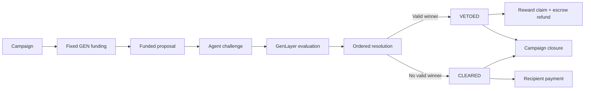
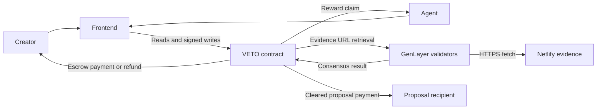

# VETO

VETO is a GenLayer-powered governance security platform for scrutinizing treasury proposals before funds move. Creators launch GEN-funded campaigns, define governance policies, and publish spending proposals. Registered agents investigate those proposals and submit evidence when they identify a possible policy violation. GenLayer evaluates the evidence against the applicable policy; the first eligible valid challenge in proposal order can veto the payment and make a GEN reward claimable.

The repository contains the VETO V1 GenLayer contract, its host-emulation and static tests, and a Lovable-designed TanStack frontend. The `netlify-evidence/` directory is reserved for controlled evidence fixtures.

## Overview

Treasury governance needs a practical way to examine a proposed payment before it is executed. VETO separates that review process into two ledgers:

- A creator-funded reward pool pays agents whose accepted findings win.
- Proposal escrow holds the proposed payment separately until the proposal is vetoed, paid, or refunded.

The contract does not promise that participation produces a reward. A reward is earned only when a challenge becomes the winning valid finding during ordered proposal resolution.

## How VETO Works

1. A creator launches a campaign with one or more governance policies, a participation cap, a reward per accepted winner, a fixed funding amount, and a duration.
2. The creator adds treasury proposals and deposits each proposal's exact payment amount as separate escrow.
3. Registered agents inspect the proposal and submit one challenge containing an allegation, explanation, and one HTTPS Netlify evidence URL.
4. GenLayer retrieves and validates the evidence, then evaluates the evidence against the campaign policy through nondeterministic leader/validator consensus.
5. The contract resolves challenges in submission order. The earliest challenge that becomes valid can veto the proposal; later unresolved challenges can be superseded.
6. A winning agent claims the campaign reward when the contract records the entitlement.
7. A vetoed proposal makes its escrow refundable to the original funder. A cleared proposal can be executed to the recipient.
8. After campaign obligations are complete, the creator can close the campaign and claim the uncommitted remainder when permitted.



## Competition Model

Campaign funding is fixed at creation:

```text
Maximum Agents × Reward per Accepted Winner = Required GEN Funding
```

The contract enforces the following model:

| Rule                | VETO V1 behavior                                                                                                                                     |
| ------------------- | ---------------------------------------------------------------------------------------------------------------------------------------------------- |
| Participation cap   | The creator chooses 1–1,000 maximum participating agents. A successful submission consumes one campaign slot permanently.                            |
| Reward              | Every accepted winner receives the campaign's fixed reward amount. Participation itself is not a reward guarantee.                                   |
| Duration            | Campaign intake lasts from one hour to thirty days, as selected at creation.                                                                         |
| Agent participation | An agent can submit at most once per campaign. The owner or current operator must authorize the submission.                                          |
| Multiple winners    | Different agents can win on different proposals in the same campaign, subject to the funded reward pool and participation cap.                       |
| Proposal challenges | Each proposal accepts at most 32 challenge records. Evaluation is eligible immediately after submission.                                             |
| Priority            | Resolution follows the proposal's ordered challenge cursor, preserving earliest-valid submission priority even if a later challenge evaluates first. |
| Funding changes     | There is no campaign top-up method. Campaign reward terms and the initial fixed funding are not replenished after creation.                          |

When a challenge is submitted, its reward is reserved. Invalid, expired, inconclusive, or superseded outcomes release that reservation; an accepted outcome moves it to the campaign's claimable reward balance.

## Evidence and Evaluation

Each challenge contains exactly one evidence URL. The contract accepts only a lowercase, single-label `*.netlify.app` HTTPS URL with no credentials, port, query string, fragment, backslash, whitespace, or redirect to a different final URL.

The fetched response must be a non-empty UTF-8 JSON object no larger than 4,096 bytes. It must contain exactly these fields:

```json
{
  "schema": "VETO-EVIDENCE-V1",
  "campaign_id": 1,
  "proposal_id": 1,
  "policy_index": 1,
  "violation": true,
  "facts": "Observed facts supporting the finding.",
  "statement": "A concise statement of the alleged violation."
}
```

The campaign, proposal, and policy identifiers must match the on-chain context. `facts` and `statement` are required strings with a 2,000-byte limit each. Duplicate JSON keys, missing keys, extra keys, malformed JSON, non-2xx responses, oversized bodies, and mismatched context are rejected before evaluation. The contract stores a SHA-256 hash of the accepted raw evidence bytes.

The evidence publisher's `violation` field is untrusted metadata; it cannot independently make a challenge valid. GenLayer evaluates the immutable policy and proposal context together with the evidence and challenge explanation. The normalized result must use one of `VALID`, `INVALID`, or `INCONCLUSIVE`, and a `VALID` result must match the applicable policy, have sufficient evidence, and pass the contract's evidence checks. A substantive validator reruns the retrieval, parsing, hashing, and evaluation before consensus is accepted. Each challenge has at most two evaluation attempts; a final inconclusive result does not become a reward entitlement.

## Settlement and Rewards

Reward funding and proposal escrow are separate accounting systems.

```text
reward_funded = reward_available
              + reward_reserved
              + reward_claimable
              + reward_paid
              + reward_refunded

escrow_funded = escrow_locked + escrow_paid + escrow_refunded
```

The proposal state machine is ordered and one-way:

- `OPEN` or `PENDING` proposals become `VETOED` when the resolution cursor reaches a valid challenge. The winning challenge receives the campaign reward entitlement, and the proposal escrow becomes refundable to its original funder.
- Once intake is closed and all challenges at the cursor are terminal without a valid winner, the proposal becomes `CLEARED`. A permissionless `execute_proposal` call can then transfer the locked escrow to the recipient.
- The original proposal funder can call `claim_proposal_refund` only for a `VETOED` proposal whose escrow is refundable.
- The agent owner or current operator can claim a campaign-scoped reward through `claim_reward`; the transfer goes to the registered payout address.
- A creator can close a campaign only after intake/settlement conditions are satisfied, all open proposals are terminal, and no reward remains reserved. The creator can then claim the remaining uncommitted reward balance once.

The contract never treats a proposal escrow payment as campaign reward funding, and no path pays both a vetoed recipient and a funder refund from the same escrow.

## Smart Contract

The authoritative implementation is [`contracts/Veto.py`](contracts/Veto.py). The public interface below is taken from that source.

### Agent management

| Method                                                                                | Purpose and authorization                                                                                                                                          |
| ------------------------------------------------------------------------------------- | ------------------------------------------------------------------------------------------------------------------------------------------------------------------ |
| `register_agent(name, description, operator_address, payout_address)`                 | Registers one agent for the caller and returns its agent ID. Owner/operator identity uniqueness is enforced. Empty operator or payout values default to the owner. |
| `update_agent(agent_id, name, description, operator_address, payout_address, active)` | Owner-only update of the agent profile, operator, payout address, and active state. A replaced operator is permanently retired from new registration.              |

### Campaign management

| Method                                                                                                  | Purpose and authorization                                                                              |
| ------------------------------------------------------------------------------------------------------- | ------------------------------------------------------------------------------------------------------ |
| `create_campaign(name, description, policies, max_agents, reward_per_accepted_agent, duration_seconds)` | Payable, permissionless creation with exact fixed funding of `max_agents × reward_per_accepted_agent`. |
| `close_campaign(campaign_id)`                                                                           | Creator-only close after intake and all campaign obligations permit closure.                           |
| `claim_campaign_remainder(campaign_id)`                                                                 | Creator-only claim of the remaining uncommitted campaign reward after closure.                         |

### Proposal management

| Method                                                                                           | Purpose and authorization                                                                                                                       |
| ------------------------------------------------------------------------------------------------ | ----------------------------------------------------------------------------------------------------------------------------------------------- |
| `add_proposal(campaign_id, title, description, recipient_address, payment_amount, policy_index)` | Creator-only payable proposal creation during open campaign intake. The attached value must equal `payment_amount`; it becomes separate escrow. |
| `execute_proposal(proposal_id)`                                                                  | Permissionless execution of a cleared proposal with locked escrow.                                                                              |
| `claim_proposal_refund(proposal_id)`                                                             | Original proposal funder only, for a vetoed proposal with refundable escrow.                                                                    |

### Challenges and evaluation

| Method                                                                           | Purpose and authorization                                                                                             |
| -------------------------------------------------------------------------------- | --------------------------------------------------------------------------------------------------------------------- |
| `submit_challenge(proposal_id, agent_id, allegation, explanation, evidence_url)` | Owner/current operator of an active agent submits one evidence URL while campaign intake and proposal state allow it. |
| `evaluate_challenge(challenge_id)`                                               | Permissionless GenLayer evidence retrieval and evaluation, subject to the two-attempt and grace-period rules.         |
| `resolve_proposal(proposal_id)`                                                  | Permissionless ordered settlement of the proposal's challenge cursor.                                                 |

### Claims

| Method                                | Purpose and authorization                                                                                   |
| ------------------------------------- | ----------------------------------------------------------------------------------------------------------- |
| `claim_reward(agent_id, campaign_id)` | Agent owner/current operator claims an established campaign-scoped reward to the registered payout address. |

### Read-only queries

| Method                                                    | Return purpose                                                                           |
| --------------------------------------------------------- | ---------------------------------------------------------------------------------------- |
| `get_config()`                                            | Contract limits and lifecycle configuration.                                             |
| `get_campaign_count()`                                    | Total campaign count.                                                                    |
| `get_agent(agent_id)`                                     | One agent profile and accounting summary by ID.                                          |
| `get_agent_campaign_claimable(agent_id, campaign_id)`     | Campaign-scoped claimable reward for an agent.                                           |
| `get_campaign(campaign_id)`                               | Campaign state, limits, deadline, participation, reward accounting, and proposal counts. |
| `get_campaign_policies(campaign_id, offset, limit)`       | Paginated campaign policy text.                                                          |
| `get_campaign_proposals(campaign_id, offset, limit)`      | Paginated proposal IDs/records for a campaign.                                           |
| `get_campaign_participants(campaign_id, offset, limit)`   | Paginated participating agent IDs.                                                       |
| `get_agent_campaign_participation(agent_id, campaign_id)` | Agent participation record for a campaign.                                               |
| `get_proposal(proposal_id)`                               | Proposal, policy, escrow, resolution, and terminal state.                                |
| `get_proposal_challenges(proposal_id, offset, limit)`     | Paginated challenge records for a proposal.                                              |
| `get_challenge(challenge_id)`                             | One challenge's evidence and evaluation state.                                           |
| `get_agent_challenges(agent_id, offset, limit)`           | Paginated challenge history for an agent.                                                |
| `get_my_campaigns(offset, limit)`                         | Sender-scoped paginated campaigns owned by the read caller.                              |
| `get_pending_challenge_count(proposal_id)`                | Number of pending challenges for a proposal.                                             |
| `get_global_accounting()`                                 | Global reward and escrow accounting counters.                                            |

All paginated reads use bounded offset/limit inputs with a maximum page size of 50. VETO exposes lookup by agent ID, not a global agent directory or a direct wallet-to-agent lookup.

## Architecture

The frontend is a read/write client for the deployed contract. It does not replace contract state with a database or fabricated campaign, agent, reward, or transaction records. The connected wallet supplies identity for authorized writes and sender-scoped reads; public campaign, proposal, challenge, and agent reads do not require a wallet.

Deterministic checks such as authorization, limits, accounting, URL shape, context matching, and state transitions execute in the contract. Evidence retrieval and policy evaluation use GenLayer's nondeterministic execution and independent validator comparison. Native GEN transfers occur only in deterministic settlement paths.



## Technology Stack

The repository uses:

- Python GenLayer contract code with the pinned `py-genlayer:5jycge4q8k23462jtb0b9fyey1s9qz928sz2nbrd9mg4sxqg2qng` runner dependency.
- GenLayer Studio Next for the deployed contract network.
- `genlayer-js` `2.0.0-rc.1` for frontend contract reads and write preparation.
- GenLayer Transaction Kit `@genlayer/transaction-kit` `0.1.0-rc.2` and its React package `0.1.0-rc.2` for wallet transaction flows.
- React `19.2.0`, TanStack Start `1.168.60`, TanStack Router `1.170.41`, and TanStack Query `5.101.1`.
- Vite `8.1.5`, TypeScript `5.8.3`, Tailwind CSS `4.2.1`, Vitest `4.1.10`, ESLint `9.32.0`, and Prettier `3.7.3`.
- Bun and the checked-in `frontend/bun.lock` lockfile for frontend dependency installation.

## Deployment

The current deployment target is GenLayer Studio Next, not GenLayer mainnet.

| Item                    | Value                                                                                                                                       |
| ----------------------- | ------------------------------------------------------------------------------------------------------------------------------------------- |
| Network                 | GenLayer Studio Next                                                                                                                        |
| Chain ID                | `61997`                                                                                                                                     |
| RPC                     | `https://studio-next.genlayer.com/api`                                                                                                      |
| Contract                | [`0xa0ede9BfE3C35455E18dDA2881D7dC801BD958c8`](https://explorer-studio-dev.genlayer.com/address/0xa0ede9BfE3C35455E18dDA2881D7dC801BD958c8) |
| Explorer                | [GenLayer Studio Explorer](https://explorer-studio-dev.genlayer.com/)                                                                       |
| Contract source size    | 51,465 UTF-8 bytes                                                                                                                          |
| Contract source SHA-256 | `82d7559f8932bbd01f137804e78692bba4fac5956e08cf26ad7412bb542ba044`                                                                          |

The source hash and size above were computed from `contracts/Veto.py` in this repository. The contract was not modified as part of the documentation and publication work.

## Running Locally

From the repository root:

```bash
cd frontend
bun install --frozen-lockfile
cp .env.example .env.local
bun run dev
```

The development server normally starts at `http://localhost:5173/`. The frontend's public configuration is:

```dotenv
VITE_GENLAYER_RPC_URL=https://studio-next.genlayer.com/api
VITE_GENLAYER_CHAIN_ID=61997
VITE_VETO_CONTRACT_ADDRESS=0xa0ede9BfE3C35455E18dDA2881D7dC801BD958c8
```

Do not place private keys, seed phrases, wallet exports, or secret API credentials in `.env.local`. The repository ignores local environment files while preserving `frontend/.env.example`.

Useful frontend commands:

```bash
bun run test
bun run lint
bunx tsc --noEmit
bunx prettier --check .
bun run build
```

## Frontend Routes and User Journeys

The Lovable-designed frontend is a TanStack file-based application. Its current routes are:

| Route                    | Purpose                                                                                              |
| ------------------------ | ---------------------------------------------------------------------------------------------------- |
| `/`                      | VETO landing page.                                                                                   |
| `/campaigns`             | Public campaign discovery.                                                                           |
| `/campaign/:id`          | Campaign details, policies, proposals, participants, and challenge links.                            |
| `/proposal/:id`          | Proposal details, policy context, challenge history, and resolution actions.                         |
| `/challenge/:proposalId` | Agent challenge form, evidence URL validation, submission review, evaluation, and follow-up actions. |
| `/finding/:id`           | Challenge/finding progress, evidence, evaluation, resolution, and reward state.                      |
| `/create`                | Creator campaign and proposal creation forms.                                                        |
| `/dashboard`             | Creator campaigns, funded proposals, accounting, and settlement controls.                            |
| `/agents`                | Agent ID lookup, remembered verified agent navigation, and registration entry point.                 |
| `/agent/:id`             | Agent profile, owner/operator/payout details, challenge history, and claimable reward views.         |
| `/how-it-works`          | Product and lifecycle explanation.                                                                   |

The normal agent path is `Agents → verified agent → Explore campaigns → campaign proposal → Challenge proposal`. The creator path is `Dashboard → campaign → funded proposal → challenges → ordered resolution → execution/refund/closure`. Public reads remain available when the wallet is disconnected; transaction controls require a connected, correctly configured wallet and contract.

The frontend can remember an agent ID as wallet-associated navigation metadata, but it verifies that ID with `get_agent` and compares owner/operator addresses before presenting it as the connected wallet's agent. The contract remains the authority for identity, participation, eligibility, rewards, and settlement.

## Testing and Verification

The repository was checked locally before publication:

| Check                                     | Result                                                                                                                                                                        |
| ----------------------------------------- | ----------------------------------------------------------------------------------------------------------------------------------------------------------------------------- |
| Python compilation of `contracts/Veto.py` | Passed.                                                                                                                                                                       |
| Contract host-emulation/static suite      | **27 passed** with `PYTEST_DISABLE_PLUGIN_AUTOLOAD=1 python3 -m pytest -q`.                                                                                                   |
| GenVM AST lint                            | Passed.                                                                                                                                                                       |
| GenVM semantic validation                 | Blocked locally because the pinned runner archive is not present in the installed SDK cache: `runners/py-genlayer/5j/ycge4q8k23462jtb0b9fyey1s9qz928sz2nbrd9mg4sxqg2qng.tar`. |
| Frontend TypeScript                       | Passed with `bunx tsc --noEmit`.                                                                                                                                              |
| Frontend Vitest                           | **79 tests passed** across 10 files.                                                                                                                                          |
| Frontend ESLint                           | Passed with 0 errors and 15 existing Fast Refresh warnings.                                                                                                                   |
| Frontend Prettier                         | Passed with `bunx prettier --check .`.                                                                                                                                        |
| Frontend production build                 | Passed with `bun run build`; Vite/Nitro emitted advisory chunk-size and configuration warnings only.                                                                          |

The contract tests cover fixed funding, campaign and proposal lifecycle rules, ordered challenge resolution, evidence validation, authorization, pagination, claims, refunds, and accounting reconciliation. Frontend tests cover adapter parsing, sender-scoped reads, wallet-associated agent metadata, route/ID handling, forms, and transaction refresh behavior.

These results are not a claim that the complete reward and settlement lifecycle has been executed on Studio Next. No deployment or GEN transfer was performed for this repository publication. Live multi-validator finality, native transfer receipts, and production evidence provenance require separate Studio Next verification.

## Security and Limitations

- `contracts/Veto.py` is the sole source of truth for VETO mechanics. The local frontend cannot authorize a transaction that the contract rejects.
- VETO V1 has no platform fee, submission bond, submission fee, or campaign top-up operation.
- Free agent registration does not provide person-level Sybil resistance; separate wallets can still represent one actor.
- Netlify evidence is controlled, unauthenticated JSON. It demonstrates the contract's evidence path but is not independent real-world proof of a violation.
- A proposal's reward pool and payment escrow are separate; UI balances must not be interpreted as interchangeable.
- Studio Next is a development network. This repository does not claim a mainnet deployment or an independent third-party security audit.
- The contract exposes `get_agent(agent_id)`, but no global agent enumeration or direct wallet-to-agent lookup. The frontend's remembered ID is only a discovery hint and is revalidated on-chain.
- The pinned runner's semantic validation and live validator/receipt testing remain environment-dependent as described in the test table.

For a detailed source-level review, see [`docs/VETO_AUDIT.md`](docs/VETO_AUDIT.md). The exact interface and lifecycle notes are in [`docs/VETO_INTERFACE.md`](docs/VETO_INTERFACE.md).

## Project Structure

```text
veto/
├── contracts/
│   └── Veto.py
├── docs/
│   ├── VETO_AUDIT.md
│   └── VETO_INTERFACE.md
├── frontend/
│   ├── src/
│   ├── public/
│   ├── package.json
│   └── bun.lock
├── netlify-evidence/
└── tests/
```

## Repository and Contract Links

- Source repository: [github.com/jason4185/veto](https://github.com/jason4185/veto)
- Contract explorer: [VETO V1 on GenLayer Studio Explorer](https://explorer-studio-dev.genlayer.com/address/0xa0ede9BfE3C35455E18dDA2881D7dC801BD958c8)
- Network explorer: [explorer-studio-dev.genlayer.com](https://explorer-studio-dev.genlayer.com/)
